# Poly Haven: Wood textures

**46 assets from [Poly Haven](https://polyhaven.com), dedicated to the public domain under [CC0](https://polyhaven.com/license).** Use them in any game, free or paid, and change them however you like; no credit is needed.

PBR textures as 1K and 2K JPG maps (colour, normal (GL and DX), roughness, AO, displacement and more). 888.9 MB in all.

This is a copy kept by [zuujis-cc0](https://github.com/zuujis-cc0) so game makers can take single files from GitHub. It is not made by or affiliated with Poly Haven: the originals, often in more formats and higher resolutions, are on [polyhaven.com](https://polyhaven.com). If they help you, consider [supporting Poly Haven](https://www.patreon.com/polyhaven/overview).

Every file is listed in [MANIFEST.tsv](MANIFEST.tsv) with its size and SHA-256. More free assets: [the Zuujis collection](https://github.com/zuujis-cc0/free-game-assets#readme).

| | | | |
| :-: | :-: | :-: | :-: |
| <a href="american_walnut_veneer">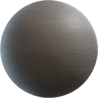</a> <b><a href="american_walnut_veneer">American Walnut Veneer</a></b> by Jenelle van Heerden · <a href="https://polyhaven.com/a/american_walnut_veneer">source</a> |  <b><a href="angli_veneer">Angli Veneer</a></b> by Jenelle van Heerden · <a href="https://polyhaven.com/a/angli_veneer">source</a> | <a href="ash_veneer">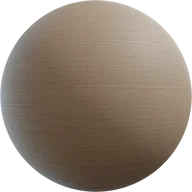</a> <b><a href="ash_veneer">Ash Veneer</a></b> by Jenelle van Heerden · <a href="https://polyhaven.com/a/ash_veneer">source</a> | <a href="bamboo_veneer">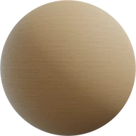</a> <b><a href="bamboo_veneer">Bamboo Veneer</a></b> by Jenelle van Heerden · <a href="https://polyhaven.com/a/bamboo_veneer">source</a> |
|  <b><a href="bamboo_wall">Bamboo Wall</a></b> by Amal Kumar · <a href="https://polyhaven.com/a/bamboo_wall">source</a> | <a href="bamboo_wall_02">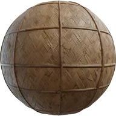</a> <b><a href="bamboo_wall_02">Bamboo Wall 02</a></b> by Amal Kumar · <a href="https://polyhaven.com/a/bamboo_wall_02">source</a> |  <b><a href="bamboo_wall_03">Bamboo Wall 03</a></b> by Amal Kumar · <a href="https://polyhaven.com/a/bamboo_wall_03">source</a> |  <b><a href="bark_bluegum">Bark Blue gum</a></b> by Dimitrios Savva · <a href="https://polyhaven.com/a/bark_bluegum">source</a> |
| <a href="bark_brown_01">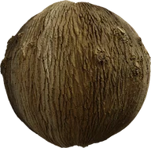</a> <b><a href="bark_brown_01">Bark Brown 01</a></b> by Rob Tuytel · <a href="https://polyhaven.com/a/bark_brown_01">source</a> | <a href="bark_brown_02">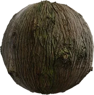</a> <b><a href="bark_brown_02">Bark Brown 02</a></b> by Rob Tuytel · <a href="https://polyhaven.com/a/bark_brown_02">source</a> |  <b><a href="bark_platanus">Bark Platanus</a></b> by Dimitrios Savva · <a href="https://polyhaven.com/a/bark_platanus">source</a> |  <b><a href="bark_willow">Bark Willow</a></b> by Dario Barresi, Dimitrios Savva · <a href="https://polyhaven.com/a/bark_willow">source</a> |
| <a href="bark_willow_02">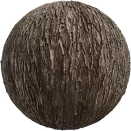</a> <b><a href="bark_willow_02">Bark Willow 02</a></b> by Charlotte Baglioni · <a href="https://polyhaven.com/a/bark_willow_02">source</a> | <a href="beam_wall_01">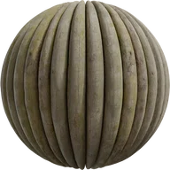</a> <b><a href="beam_wall_01">Beam Wall 01</a></b> by Rob Tuytel · <a href="https://polyhaven.com/a/beam_wall_01">source</a> | <a href="black_oak_veneer">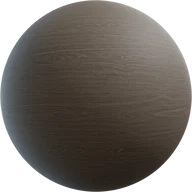</a> <b><a href="black_oak_veneer">Black Oak Veneer</a></b> by Jenelle van Heerden · <a href="https://polyhaven.com/a/black_oak_veneer">source</a> |  <b><a href="black_painted_planks">Black Painted Planks</a></b> by Dimitrios Savva · <a href="https://polyhaven.com/a/black_painted_planks">source</a> |
| <a href="black_walnut_veneer_01">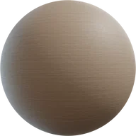</a> <b><a href="black_walnut_veneer_01">Black Walnut Veneer 01</a></b> by Jenelle van Heerden · <a href="https://polyhaven.com/a/black_walnut_veneer_01">source</a> | <a href="black_walnut_veneer_02">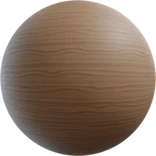</a> <b><a href="black_walnut_veneer_02">Black Walnut Veneer 02</a></b> by Jenelle van Heerden · <a href="https://polyhaven.com/a/black_walnut_veneer_02">source</a> | <a href="black_walnut_veneer_03">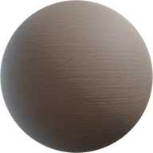</a> <b><a href="black_walnut_veneer_03">Black Walnut Veneer 03</a></b> by Jenelle van Heerden · <a href="https://polyhaven.com/a/black_walnut_veneer_03">source</a> |  <b><a href="blue_painted_planks">Blue Painted Planks</a></b> by Rob Tuytel · <a href="https://polyhaven.com/a/blue_painted_planks">source</a> |
|  <b><a href="brown_planks_03">Brown Planks 03</a></b> by Rob Tuytel · <a href="https://polyhaven.com/a/brown_planks_03">source</a> | <a href="brown_planks_04">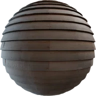</a> <b><a href="brown_planks_04">Brown Planks 04</a></b> by Rob Tuytel · <a href="https://polyhaven.com/a/brown_planks_04">source</a> | <a href="brown_planks_05">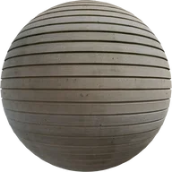</a> <b><a href="brown_planks_05">Brown Planks 05</a></b> by Rob Tuytel · <a href="https://polyhaven.com/a/brown_planks_05">source</a> |  <b><a href="brown_planks_07">Brown Planks 07</a></b> by Rob Tuytel · <a href="https://polyhaven.com/a/brown_planks_07">source</a> |
|  <b><a href="brown_planks_08">Brown Planks 08</a></b> by Rob Tuytel · <a href="https://polyhaven.com/a/brown_planks_08">source</a> | <a href="brown_planks_09">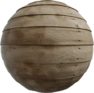</a> <b><a href="brown_planks_09">Brown Planks 09</a></b> by Rob Tuytel · <a href="https://polyhaven.com/a/brown_planks_09">source</a> |  <b><a href="cherry_veneer">Cherry Veneer</a></b> by Jenelle van Heerden · <a href="https://polyhaven.com/a/cherry_veneer">source</a> |  <b><a href="chinese_cedar_bark">Chinese Cedar Bark</a></b> by Charlotte Baglioni · <a href="https://polyhaven.com/a/chinese_cedar_bark">source</a> |
|  <b><a href="chinese_hackberry_bark">Chinese Hackberry Bark</a></b> by Charlotte Baglioni · <a href="https://polyhaven.com/a/chinese_hackberry_bark">source</a> | <a href="coated_pine">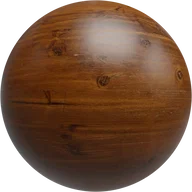</a> <b><a href="coated_pine">Coated Pine</a></b> by Charlotte Baglioni, Rico Cilliers · <a href="https://polyhaven.com/a/coated_pine">source</a> | <a href="coated_pine_02">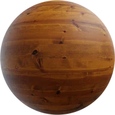</a> <b><a href="coated_pine_02">Coated Pine 02</a></b> by Charlotte Baglioni, Jenelle van Heerden · <a href="https://polyhaven.com/a/coated_pine_02">source</a> |  <b><a href="dark_paneled_wood">Dark Paneled Wood</a></b> by Dimitrios Savva · <a href="https://polyhaven.com/a/dark_paneled_wood">source</a> |
| <a href="dark_planks">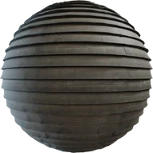</a> <b><a href="dark_planks">Dark Planks</a></b> by Rob Tuytel · <a href="https://polyhaven.com/a/dark_planks">source</a> | <a href="dark_wood">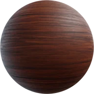</a> <b><a href="dark_wood">Dark Wood</a></b> by Dario Barresi, Dimitrios Savva, Rico Cilliers · <a href="https://polyhaven.com/a/dark_wood">source</a> |  <b><a href="dark_wooden_planks">Dark Wooden Planks</a></b> by Amal Kumar · <a href="https://polyhaven.com/a/dark_wooden_planks">source</a> | <a href="diagonal_parquet">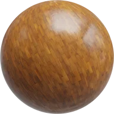</a> <b><a href="diagonal_parquet">Diagonal Parquet</a></b> by Jenelle van Heerden, Sergej Majboroda · <a href="https://polyhaven.com/a/diagonal_parquet">source</a> |
|  <b><a href="distressed_painted_planks">Distressed Painted Planks</a></b> by Rob Tuytel · <a href="https://polyhaven.com/a/distressed_painted_planks">source</a> | <a href="embedded_plank_flooring">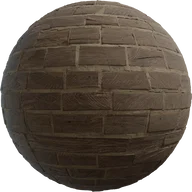</a> <b><a href="embedded_plank_flooring">Embedded Plank Flooring</a></b> by Dimitrios Savva · <a href="https://polyhaven.com/a/embedded_plank_flooring">source</a> |  <b><a href="eucalyptus_bark">Eucalyptus Bark</a></b> by Charlotte Baglioni · <a href="https://polyhaven.com/a/eucalyptus_bark">source</a> | <a href="european_walnut_veneer_04">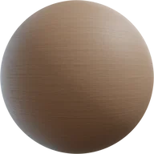</a> <b><a href="european_walnut_veneer_04">European Walnut Veneer 04</a></b> by Jenelle van Heerden · <a href="https://polyhaven.com/a/european_walnut_veneer_04">source</a> |
| <a href="european_walnut_veneer_05">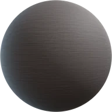</a> <b><a href="european_walnut_veneer_05">European Walnut Veneer 05</a></b> by Jenelle van Heerden · <a href="https://polyhaven.com/a/european_walnut_veneer_05">source</a> | <a href="fever_tree_bark">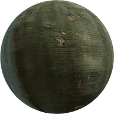</a> <b><a href="fever_tree_bark">Fever Tree Bark</a></b> by Dimitrios Savva · <a href="https://polyhaven.com/a/fever_tree_bark">source</a> | <a href="fine_grained_wood">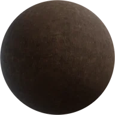</a> <b><a href="fine_grained_wood">Fine Grained Wood</a></b> by Rob Tuytel · <a href="https://polyhaven.com/a/fine_grained_wood">source</a> | <a href="flamed_black_veneer">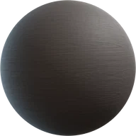</a> <b><a href="flamed_black_veneer">Flamed Black Veneer</a></b> by Jenelle van Heerden · <a href="https://polyhaven.com/a/flamed_black_veneer">source</a> |
|  <b><a href="green_rough_planks">Green Rough Planks</a></b> by Rob Tuytel · <a href="https://polyhaven.com/a/green_rough_planks">source</a> | <a href="grey_lati_veneer">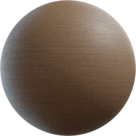</a> <b><a href="grey_lati_veneer">Grey Lati Veneer</a></b> by Jenelle van Heerden · <a href="https://polyhaven.com/a/grey_lati_veneer">source</a> |  |  |

---

Kept up to date by this repository's own [update workflow](.github/workflows/update.yml), with code and plan from [cc0-mirror](https://github.com/zuujis-cc0/cc0-mirror). Something wrong? [Open an issue there](https://github.com/zuujis-cc0/cc0-mirror/issues/new) or use the [private report form](https://games.zuujis.com/report).
